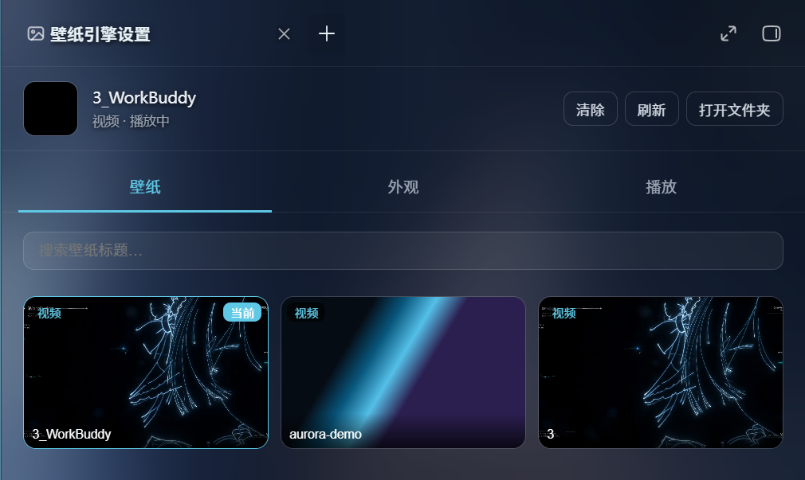

# WorkBuddy Wallpaper Engine

> 给 WorkBuddy 桌面端换上**本机的视频 / 图片壁纸**，配 iOS 液态玻璃界面。


它不改 `app.asar`、不改安装目录，只通过 **本地 CDP 注入**把壁纸图层垫到界面后方，
并把 WorkBuddy 的设计变量接到壁纸上，做出半透明 + `backdrop-filter` 模糊的玻璃质感。

灵感来自 DSH 插件 [`elysia395/dsh-wallpaper-engine`](https://github.com/elysia395/dsh-wallpaper-engine)，
按 WorkBuddy 的注入体系重新实现。

---

## 效果



右下角会出现一个「壁纸」按钮，点开即可选壁纸、调玻璃透明度 / 亮度 / 饱和度、切配色与适配方式。

---

## 特性

- **壁纸发现**：扫描你指定的文件夹，识别
  `.mp4 / .webm / .mov / .m4v / .ogv / .mkv / .gif / .png / .jpg / .jpeg / .webp / .avif / .bmp`
- **真实渲染**：视频用 `<video>` 图层循环播放，图片 / GIF 用 ``，垫在应用根节点之下
- **液态玻璃**：面板半透明 + 背景模糊，透明度 0–60% 可调，6 套配色预设
- **界面内选择器**：不用命令行，右下角按钮点开就能换
- **省电**：窗口失焦 / 最小化时暂停视频，电池供电时暂停（两项都可关）
- **持久化**：设置存在宿主端 `config.json`，重启、换端口都不丢
- **零依赖**：纯 Node 标准库，不需要 `npm install`
- **开机自启**：装一次，之后打开 WorkBuddy 就有壁纸

---

## 快速开始

### 前置条件

- WorkBuddy 桌面端（Windows）
- Node.js 18+
- 你自己的壁纸文件（**不依赖 Wallpaper Engine / Steam**）

### 方式一：装成 WorkBuddy 技能（推荐）

把它作为技能装进 WorkBuddy，之后可以直接对 AI 说「换个壁纸」：

```powershell
.\install-skill.bat
```

### 方式二：装开机自启（让它一直生效）

```powershell
.\install-autostart.bat
```

它会做三件事：

1. 写入用户级环境变量 `WORKBUDDY_REMOTE_DEBUGGING_PORT=9223`
   （WorkBuddy 官方支持该变量，启动时会自己带上 CDP 调试端口）
2. 把调试参数写进 WorkBuddy 的桌面 / 开始菜单快捷方式
   （**启动参数立刻生效**，不依赖注销刷新环境变量）
3. 在「启动」文件夹放一个隐藏启动器，登录时静默拉起**监督进程**

> **装完之后：关掉当前 WorkBuddy，从桌面或开始菜单快捷方式重新打开。**
> 之后无论怎么重启 WorkBuddy，壁纸都会自动出现。

### 方式三：只临时用一次

```powershell
.\apply-wallpaper.bat
```

注意：它会**关闭并重启 WorkBuddy**（为了带上调试端口），先保存工作。

---

## 界面内操作

打开 WorkBuddy 后，右下角有一个「壁纸」按钮：

| 操作 | 说明 |
|---|---|
| 点缩略图 | 立即切换壁纸 |
| 玻璃 | 拖动调整面板透明度（0–60%） |
| 亮度 / 饱和度 | 调整壁纸本身的观感 |
| 配色 | 6 套预设（极光 / 晨曦 / …） |
| 适配 | 覆盖 / 完整 / 拉伸 |
| 窗口失焦时暂停 | 不看着它就不播，省电 |
| 电池供电时暂停 | 笔记本用电池时不播，省电 |
| 打开文件夹 | 资源管理器打开壁纸目录 |
| 重新扫描 | 手动重扫壁纸库 |

---

## 命令行

不需要装任何依赖，`node` 直接跑：

```bash
node src/cli.mjs status                    # 注入状态 + 当前配置
node src/cli.mjs list                      # 扫描并列出壁纸（▶ 标记当前）
node src/cli.mjs set <id|名称片段>          # 切换壁纸
node src/cli.mjs clear                     # 清除壁纸，恢复原生外观
node src/cli.mjs folder-add "D:\壁纸"       # 添加壁纸文件夹
node src/cli.mjs folder-remove "D:\壁纸"    # 移除壁纸文件夹
node src/cli.mjs folders                   # 列出壁纸文件夹
node src/cli.mjs scan                      # 重新扫描
node src/cli.mjs open                      # 资源管理器打开壁纸文件夹
node src/cli.mjs start / stop              # 启动 / 停止守护进程
node src/cli.mjs schemes                   # 列出配色预设
node scripts/autostart.mjs status          # 自启状态
node scripts/watchdog.mjs --once           # 只跑一次检查
```

`set` / `clear` / `folder-add` 会直接改 `config.json`，
运行中的守护进程会在一个轮询周期（约 0.3 秒）内同步并刷新界面，**无需重启**。

---

## 卸载

| 想做什么 | 命令 |
|---|---|
| 临时摘掉壁纸（下次登录还会回来） | `.\stop-wallpaper.bat` |
| 彻底取消开机自启 | `.\uninstall-autostart.bat` |
| 移除 WorkBuddy 技能 | `.\uninstall-skill.bat` |

`stop-wallpaper.bat` 会先通过 CDP 摘除注入的样式 / 媒体层 / 面板，再结束守护进程。
**WorkBuddy 本体始终不被修改。**

---

## 工作原理（简述）

```
install-autostart.bat（一次）
  ├─ 用户级环境变量 WORKBUDDY_REMOTE_DEBUGGING_PORT=9223
  ├─ WorkBuddy 快捷方式 + --remote-debugging-port=9223
  └─ 「启动」文件夹 → 隐藏启动器
       └─ scripts/watchdog.mjs   每 15s 确认一次守护进程，掉了就补起来
            └─ spawn(detached) src/cli.mjs serve

src/cli.mjs serve（单实例）
  └─ src/engine.mjs  每 300ms 一轮：
       ├─ 同步 config.json（外部命令改的配置）
       ├─ 给每个 app.asar 渲染页注入 UI（page-script.js + panel-style.css）
       ├─ 消费页面动作 → 落盘 → 重新注入
       └─ 每 15s 重扫壁纸库
```

页面与宿主之间是**双通道**：

- **直达通道（优先）**：宿主用 `Runtime.addBinding` 注册 `window.__wbWeAction`，
  需要即时响应的动作（打开文件夹 / 重新扫描）直接调用，CDP 事件立刻推给宿主并打断休眠
- **轮询队列（兜底）**：`window.__wbWe.queue` 每 300ms 被取走一次；
  绑定注册失败或页面在就绪前就调用，会自动落到这条路

详见 **[docs/ARCHITECTURE.md](docs/ARCHITECTURE.md)**。

---

## 常见问题

遇到「重启后没有壁纸」「打开文件夹很慢」「点了没反应」这类问题，
先跑一句：

```bash
node scripts/autostart.mjs status
```

大多数情况一眼就能定位。完整的排查手册见
**[docs/TROUBLESHOOTING.md](docs/TROUBLESHOOTING.md)**。

几个最常见的：

<details>
<summary><b>重启 WorkBuddy 后没有壁纸</b></summary>

看 `status` 输出：

| 现象 | 原因 | 处理 |
|---|---|---|
| `CDP 未就绪` | WorkBuddy 不是带调试端口启动的 | 从**桌面 / 开始菜单快捷方式**重开；或用别的方式启动过，则注销一次 |
| `监督进程 未运行` | 登录项还没触发过（只重启了应用，没注销） | 双击 `install-autostart.bat` |
| 都正常但界面没壁纸 | 注入被 React 重渲染冲掉 | 看 `engine.log` 尾部有无异常 |
</details>

<details>
<summary><b>壁纸是黑的 / 不动</b></summary>

大概率是**省电开关**把它暂停了。视频暂停时停在第一帧，有些片子第一帧接近全黑，
看起来就像「壁纸没显示」。

在设置面板里关掉「电池供电时暂停」或「窗口失焦时暂停」即可。
用命令行也能查：

```bash
node src/cli.mjs status
```
</details>

<details>
<summary><b>点「打开文件夹」很慢 / 点了没反应</b></summary>

守护进程没在跑时，动作会堆在队列里没人消费，表现为「点了没反应」或「过很久才执行」。

```bash
node scripts/autostart.mjs status   # 看「守护进程」是不是 未运行
```

界面上也会给反馈：宿主在线时按钮闪「处理中…」，不在线时闪「引擎未运行」。
</details>

---

## 已知边界

- 核心版**不含** Scene 场景壁纸 WebGL 渲染、ffmpeg 帧率上限转码、视频倍速 / 翻转
- 视频通过 `file://` URL 加载；个别编码的 `.mkv` 可能无法播放，优先用 `.mp4`(H.264) 或 `.webm`
- 界面适配依赖 WorkBuddy 的 `--cb-*` 变量与 `[data-view-id]` 锚点，官方大版本更新后可能需要重新对齐
- 目前只在 **Windows** 上验证过（注入器本身是纯 Node，跨平台）

### ⚠️ 安全提示

**装开机自启意味着 WorkBuddy 会长期开着 CDP 调试端口**（只绑定回环 `127.0.0.1`）。
本机上的任何程序都能借此控制 WorkBuddy 界面——这是「自动生效」换来的代价。
介意的话跑 `uninstall-autostart.bat` 关掉，回到手动 `apply-wallpaper.bat`。

除此之外：**绝不修改 `app.asar` / 安装目录**；壁纸文件夹只读扫描，不移动、不删除任何文件。

---

## 开发

```bash
node --check src/cli.mjs        # 语法自检
node src/cli.mjs status         # 看注入状态
node src/cli.mjs list           # 看壁纸库
```

改 `src/page-script.js` / `src/panel-style.css` 后**必须重新注入**才生效：

```bash
node src/cli.mjs stop && node src/cli.mjs start
```

> 守护进程有单实例保护，而且**已经在跑的守护进程不会主动重新注入**
> （只有配置变更或新会话才注入）。所以改完代码要 `stop` + `start`，
> 否则页面里跑的还是旧代码。

改完源码后，如果之前装过技能，记得同步一份到技能目录：

```powershell
.\install-skill.bat
```

### 发版

```bash
node scripts/release.mjs 1.1.0 --notes "新增：视频倍速"
```

它会改版本号、写 CHANGELOG、重新打包，然后把后续 git 命令打印出来（**不替你推送**）。
完整清单见 **[docs/RELEASING.md](docs/RELEASING.md)**。

打包用的是自带的 `scripts/zip.mjs`（纯 Node，只用内置 zlib），不依赖 tar / PowerShell。

---

## 许可

[MIT](LICENSE)
